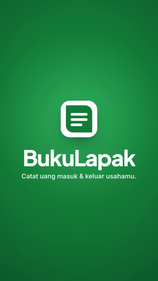

# BukuLapak — Pembukuan & Catatan Kas UMKM

[](https://www.typescriptlang.org/)
[](https://preactjs.com/)
[](https://workers.cloudflare.com/)
[](https://developers.cloudflare.com/d1/)
[](docs/teknis.md)
[](docs/teknis.md)
[](LICENSE)
[](https://github.com/rizalahmaddd/bukulapak/actions/workflows/ci.yml)
[](https://bukulapak.solusikoding.com)

**Stack:** TypeScript · Preact · Vite · Hono · IndexedDB · Cloudflare Workers · Cloudflare D1 · Cloudflare Durable Objects · WebSockets · PWA

Aplikasi pembukuan dan catatan kas untuk warung dan UMKM. Menjawab dua pertanyaan paling mendasar: **"Usaha saya untung berapa?"** dan **"Uang saya ada di mana?"** tanpa pusing istilah akuntansi. Langsung bisa dipakai tanpa daftar, data tersimpan di perangkat, dan tetap jalan saat offline.

🌐 **Demo:** [bukulapak.solusikoding.com](https://bukulapak.solusikoding.com)

<p align="center">
  
</p>

## Fitur Utama

- **Catat Cepat & Tanpa Daftar**: Buka web langsung catat transaksi (< 5 detik), data tersimpan aman di HP (IndexedDB).
- **Untung & Uang Ada**: Tahu pasti untung bersih usaha dan posisi uang riil (laci kasir, rekening bank, saldo QRIS).
- **Uang Pribadi vs Usaha**: Ambil uang pribadi (prive) atau tambah modal tanpa merusak hitungan untung/rugi.
- **QRIS & Potongan MDR**: Potongan admin dihitung otomatis; saldo QRIS dipisahkan sampai dicairkan ke bank.
- **Kasbon & Tagih WA**: Catat hutang/piutang dan kirim rincian nota tagihan langsung ke WhatsApp pelanggan sekali klik.
- **Buka/Tutup Kasir (Shift)**: Hitung modal awal di laci dan rekap uang fisik saat tutup; selisih kas tercatat otomatis.
- **DP Pesanan**: Uang muka pesanan masuk kasir, tapi untung baru diakui saat pesanan selesai diserahkan.
- **100% Offline-First & Sync**: Tetap berfungsi tanpa internet, sinkron otomatis ke cloud saat online via Cloudflare Workers & D1.

## Mulai Cepat

```bash
npm install       # pasang dependensi
npm run dev       # jalankan di http://localhost:5173
npm run build     # build produksi ke folder dist/
```

## Dokumentasi

Detail arsitektur, mesin pembukuan *double-entry*, sinkronisasi, dan deployment: [Dokumentasi Teknis](docs/teknis.md).

## Dukung & Donasi

Jika proyek ini bermanfaat, dukung pengembangannya melalui **QRIS**:

<p align="center">
  
  <br>
  <em>Scan QRIS menggunakan BCA, Mandiri, BRI, GoPay, OVO, DANA, ShopeePay, atau mobile banking lainnya.</em>
</p>

## Kontak

Dikembangkan oleh **rizalahmaddd**:
- **WhatsApp**: [+62 857-7777-5477](https://wa.me/6285777775477)
- **GitHub**: [@rizalahmaddd](https://github.com/rizalahmaddd)
- **Lokasi**: Kota Malang, Jawa Timur, Indonesia

## Lisensi

Proyek ini dilisensikan di bawah lisensi [MIT License](LICENSE).
